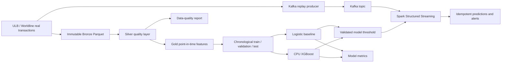
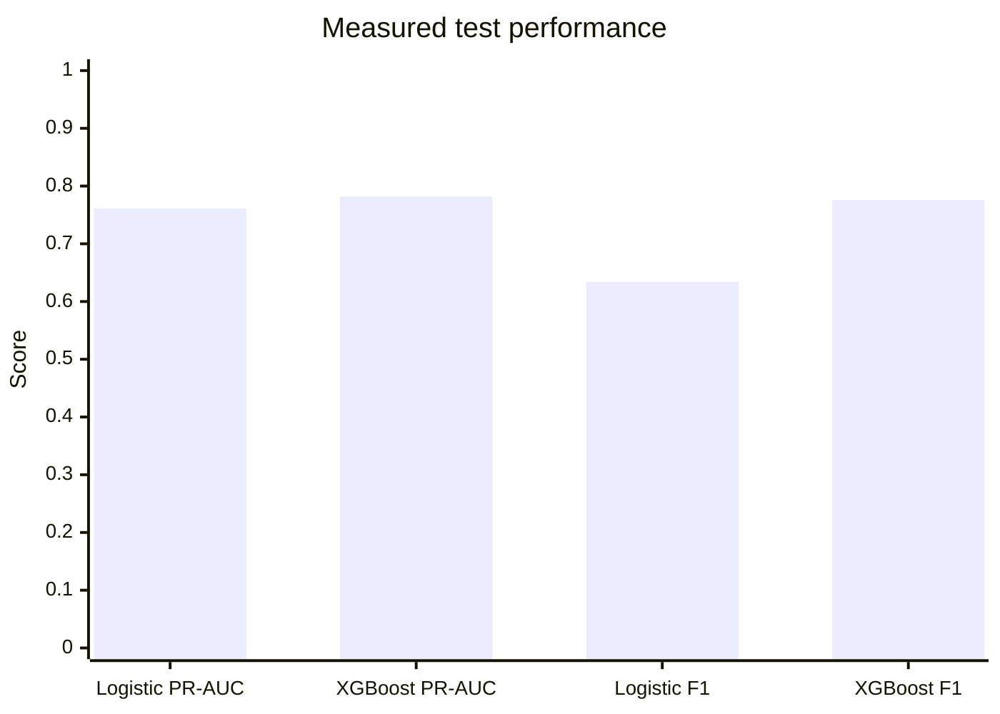
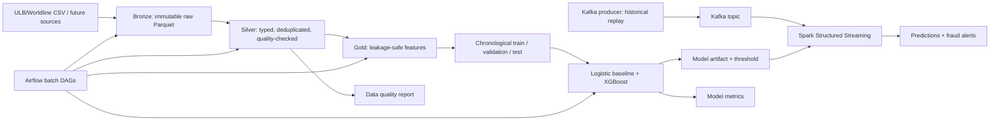

# FinGuard AI

FinGuard AI is a portfolio project for detecting suspicious financial transactions with batch data engineering, machine learning, and event-driven streaming.

> Status: Milestone 1 — dataset decision, architecture, repository bootstrap, and Phase 1 EDA foundation.

## Project presentation

FinGuard AI is a fraud-detection platform built on the real anonymized ULB/Worldline credit-card dataset. It combines distributed data profiling, quality controls, leakage-safe feature engineering, CPU XGBoost modeling, Kafka replay, and Spark Structured Streaming.

### End-to-end platform



### Measured model comparison

The benchmark uses a chronological 60/20/20 split and selects the classification threshold on validation data only.



XGBoost achieved higher PR-AUC, F1, precision, and precision-at-K in the recorded run; logistic regression retained higher recall. Full results are in [docs/benchmark.md](docs/benchmark.md) and [reports/benchmark_ulb.json](reports/benchmark_ulb.json).

### Interview-ready project story

1. **Business problem:** identify suspicious transactions while balancing missed fraud against investigator workload.
2. **Engineering decision:** preserve raw data, validate it in Silver, and prevent future information from entering Gold features.
3. **Modeling decision:** use logistic regression as a transparent baseline, then CPU XGBoost with class weighting and validation threshold selection.
4. **Streaming decision:** replay real historical events through Kafka and score micro-batches with Spark; use stable event IDs and idempotent writes.
5. **Trade-off:** this demonstrates production patterns locally, but it is not a production banking system because it lacks real customer identifiers, high availability, governance, and representative current data.

## Dataset decision

The project uses the **ULB/Worldline Credit Card Fraud Detection dataset**, a public anonymized dataset of real credit-card transactions. It contains 284,807 transactions over two days in September 2013, with 492 fraud cases (about 0.172%). The 28 `V1`–`V28` fields are PCA-transformed for confidentiality; `Time`, `Amount`, and `Class` remain interpretable. This is a real-data project, not a PaySim simulation.

| Dataset | Strengths | Trade-offs | Decision |
| --- | --- | --- | --- |
| ULB/Worldline Credit Card Fraud Detection | Real anonymized transactions; severe class imbalance; 150 MB CSV; straightforward chronological replay | PCA fields reduce business interpretability; no customer/card ID, so customer-history features are not legitimate | **Use first** |
| IEEE-CIS Fraud Detection | Real e-commerce transactions; richer identity/device/card fields and missingness | Greater operational complexity and more involved feature semantics | Future expansion |
| PaySim | Easy entity-level streaming demonstration | Synthetic transactions and behavior | Not used as the project dataset |

The dataset is available through the [ULB Machine Learning Group Kaggle page](https://www.kaggle.com/mlg-ulb/creditcardfraud) and also indexed by [OpenML dataset 1597](https://www.openml.org/search?id=1597). Download it manually or with the Kaggle CLI, then place `creditcard.csv` at `data/raw/creditcard.csv`. The raw file is gitignored.

## Quick start

```bash
python -m venv .venv
source .venv/bin/activate
pip install -r requirements-dev.txt

# Download the real ULB/Worldline dataset first, then place it at:
# data/raw/creditcard.csv

# Run the Phase 1 Spark EDA job after installing PySpark and Java 17
python -m finguard.phase1.eda \
  --input data/raw/creditcard.csv \
  --output reports/phase1 \
  --master local[2]

pytest -q
```

For the real-data run, execute `scripts/download_ulb_dataset.sh` after configuring the Kaggle CLI, or download the file manually and place it under `data/raw/`; raw data is intentionally gitignored. See [Phase 1 EDA](docs/phase-1-eda.md) for the command, expected report files, and interpretation guide.

The reproducible offline benchmark is documented in [docs/benchmark.md](docs/benchmark.md) and generated at `reports/benchmark_ulb.json`. It compares balanced logistic regression with CPU XGBoost using a chronological split and a validation-selected threshold; it does not report invented results.

## Architecture at a glance



The prototype uses one Kafka broker in KRaft mode, `local[2]` Spark, Parquet, and bounded micro-batches. Production-scale concerns are documented rather than implied by the prototype deployment.

## What interviewers should notice

- **Data correctness:** raw data is preserved, invalid records are quarantined, and duplicate handling is explicit.
- **Leakage prevention:** chronological splitting and point-in-time feature rules prevent future information from entering training or inference.
- **Business-aligned evaluation:** PR-AUC, recall, precision, F1, precision-at-K, confusion matrices, and threshold selection are reported instead of accuracy alone.
- **Distributed-systems reasoning:** Kafka offsets, replay, watermarking, checkpointing, late events, backpressure, and idempotent sinks are addressed explicitly.
- **Production awareness:** the prototype distinguishes demonstrated behavior from requirements such as high availability, schema governance, model drift monitoring, and regulated-data controls.

The safe workflow is sequential: EDA → batch transforms → model training → streaming demo. Docker Compose limits are included for the infrastructure services, but the full stack is not intended to be started simultaneously on this machine.

## Repository map

```text
FinGuardAI/
├── README.md
├── pyproject.toml
├── requirements.txt                  # runtime dependencies
├── requirements-dev.txt              # runtime + tests
├── docker-compose.yml
├── dags/                             # Airflow orchestration (later milestones)
├── data/{raw,bronze,silver,gold,quarantine}/
├── docs/
│   ├── phase-1-eda.md
│   ├── system-design.md
│   ├── roadmap.md
│   └── limitations.md
├── notebooks/                        # exploratory notebooks, added per phase
├── reports/                          # generated reports; only .gitkeep tracked
├── scripts/                          # benchmark/demo entry points
├── src/finguard/
│   ├── config.py
│   └── phase1/{eda.py,stats.py}
├── tests/
│   └── phase1/{test_stats.py,test_schema.py}
└── docker/
```

## Milestones

1. **Phase 1 — EDA:** real ULB/Worldline dataset, statistical profile, missingness and class-imbalance analysis.
2. **Phase 2 — Quality + medallion layers:** schema validation, quarantine, deduplication, and Silver/Gold contracts.
3. **Phase 3 — Features:** point-in-time-safe temporal, amount, and behavioral features.
4. **Phase 4 — Models:** logistic baseline, CPU XGBoost, chronological evaluation, threshold selection, and model card.
5. **Phase 5 — Kafka + streaming:** replay producer, Spark Structured Streaming, checkpointing, watermarking, idempotent sink.
6. **Phase 6 — Airflow + observability:** batch DAGs, data-quality reports, latency/throughput measurements, and recovery drills.
7. **Phase 7 — Interview demo:** one-command local demo, diagrams, limitations, and tested walkthrough.

The detailed plan and theory for the first milestone are in [docs/phase-1-eda.md](docs/phase-1-eda.md); the complete system design is in [docs/system-design.md](docs/system-design.md).

## Portfolio prototype boundary

This project demonstrates engineering decisions on a small machine using public anonymized real transactions. It is not a production banking system: it has no identifiable customer data, no regulatory controls, no high-availability Kafka cluster, no online feature store, and no claim of production fraud-loss reduction. Every later phase will record measured results instead of inventing benchmarks.
