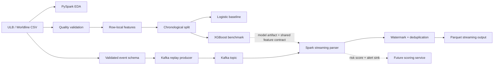

# FinGuard AI

FinGuard AI is a fraud-detection engineering project built around the public anonymized ULB/Worldline credit-card dataset. It demonstrates data profiling, data-quality validation, leakage-aware feature preparation, imbalanced classification, Kafka event replay, and Spark Structured Streaming concepts.

## Current status

**Phase 1 is implemented and measured.** The benchmark and CI paths are working. The Kafka and Spark streaming components are functional foundations, but the repository does not claim an end-to-end production scoring service yet.

This distinction is intentional: the README reports what is implemented and verified, while unfinished production components are listed as next steps.

## What is implemented

- Real ULB/Worldline dataset ingestion instructions and schema contract
- PySpark EDA over the full dataset
- Missing-value, schema, duplicate, target, and amount validation
- Quarantine output for invalid rows
- Row-local temporal and amount features
- Chronological 60/20/20 train/validation/test split
- Logistic Regression baseline
- CPU XGBoost benchmark with validation-selected threshold
- Precision, recall, F1, ROC-AUC, PR-AUC, precision-at-K, confusion matrix, and timing metrics
- Deterministic Kafka event schema and CSV replay producer
- Spark Structured Streaming Kafka parser with watermarking and event deduplication
- Airflow DAG skeleton for input validation, EDA, and benchmark execution
- GitHub Actions workflow for tests, real-data benchmark, and Spark EDA

## What is not implemented yet

- The Gold feature set does not contain customer-history features because this dataset has no customer/card identifier.
- The streaming job currently parses, watermarks, deduplicates, and writes events; its `risk_score` is intentionally not populated until model-artifact loading and feature parity are completed.
- Bronze/Silver/Gold Parquet jobs are documented but not yet exposed as separate production-grade commands.
- Kafka integration and streaming restart behavior have not been run against a live broker in CI.
- The Airflow DAG is a local orchestration skeleton, not a complete production scheduler deployment.
- No production claims are made about fraud reduction, availability, latency, compliance, or current fraud behavior.

## Architecture

The solid path is implemented today. The dashed path is the intended next integration step.



## Dataset

The project uses the [ULB Machine Learning Group credit-card dataset on Kaggle](https://www.kaggle.com/mlg-ulb/creditcardfraud), also indexed as [OpenML dataset 1597](https://www.openml.org/search?id=1597). It contains 284,807 transactions from two days in September 2013 and 492 fraud labels. `V1`–`V28` are PCA-transformed for confidentiality; `Time`, `Amount`, and `Class` are the remaining interpretable fields.

The dataset has no stable customer/card identifier. Therefore, this project does not invent customer velocity, customer history, merchant history, or card-level behavior features. That is a limitation of the data, not an undocumented assumption.

Download the CSV under the dataset’s published terms and place it at:

```text
data/raw/creditcard.csv
```

The raw file is ignored by Git. The helper script is [scripts/download_ulb_dataset.sh](scripts/download_ulb_dataset.sh).

## Quick start

```bash
python -m venv .venv
source .venv/bin/activate
pip install -e . -r requirements-dev.txt

# After downloading data/raw/creditcard.csv:
PYTHONPATH=src python -m finguard.phase1.eda \
  --input data/raw/creditcard.csv \
  --output reports/phase1 \
  --master 'local[2]'

PYTHONPATH=src python -m finguard.benchmark \
  --input data/raw/creditcard.csv \
  --output reports/benchmark_ulb.json

PYTHONPATH=src pytest -q
```

Spark 3.5 is run with Java 17 in CI. The full local validation command is:

```bash
JAVA_HOME=/path/to/java-17 ./scripts/ci_local.sh
```

## Measured benchmark

Configuration: full ULB dataset, exact duplicates removed, chronological 60/20/20 split, class-weighted logistic regression, CPU XGBoost with histogram training, and threshold selected on validation F1.

| Model | PR-AUC | ROC-AUC | Precision | Recall | F1 | Precision@K |
| --- | ---: | ---: | ---: | ---: | ---: | ---: |
| Logistic Regression | 0.7611 | 0.9841 | 0.5268 | 0.7973 | 0.6344 | 0.7297 |
| XGBoost | **0.7820** | 0.9804 | **0.8667** | 0.7027 | **0.7761** | **0.7568** |

XGBoost produced better PR-AUC, precision, F1, and precision-at-K in the recorded run. Logistic Regression produced higher recall. These are one offline experiment, not universal performance claims.

Details and measured timings are in [docs/benchmark.md](docs/benchmark.md); the machine-readable output is [reports/benchmark_ulb.json](reports/benchmark_ulb.json).

## Validation and CI

The repository includes [.github/workflows/ci.yml](.github/workflows/ci.yml), which runs:

1. Python compilation, pytest, and Ruff.
2. Real ULB dataset download from the OpenML public mirror when the CI cache is empty.
3. The full benchmark.
4. Full Spark EDA with Java 17.
5. Benchmark and EDA report artifact upload.

The local equivalent has been run successfully: 8 tests passed, Ruff passed, the full real-data benchmark passed, and Spark EDA generated the profile for all 284,807 rows.

## Interview focus

- How duplicate handling changes the fraud population and why it must be documented.
- Why chronological evaluation is safer than a random split for transaction data.
- Why PR-AUC, recall, precision, and investigation capacity matter more than accuracy.
- Why a threshold is selected separately from the model and fitted using validation data.
- Why the absence of an entity identifier prevents legitimate customer-history features.
- How Kafka offsets, event IDs, checkpoints, watermarks, late events, and idempotent sinks work together.
- Which parts of this repository are demonstrated locally and which require production infrastructure.

## Repository structure

```text
FinGuardAI/
├── .github/workflows/ci.yml
├── dags/finguard_batch.py
├── data/{raw,bronze,silver,gold,quarantine}/
├── docs/{benchmark,phase-1-eda,roadmap,system-design}.md
├── reports/benchmark_ulb.json
├── scripts/{ci_local.sh,download_ulb_dataset.sh,stream_ulb.py}
├── src/finguard/
│   ├── benchmark.py
│   ├── config.py
│   ├── features.py
│   ├── quality.py
│   ├── phase1/{eda,stats}.py
│   └── streaming/{events,producer}.py
└── tests/
```

## Documentation

- [Benchmark methodology and results](docs/benchmark.md)
- [Phase 1 EDA theory and validation](docs/phase-1-eda.md)
- [System design and trade-offs](docs/system-design.md)
- [Implementation roadmap](docs/roadmap.md)
- [Docker Compose Kafka configuration](docker-compose.yml)
