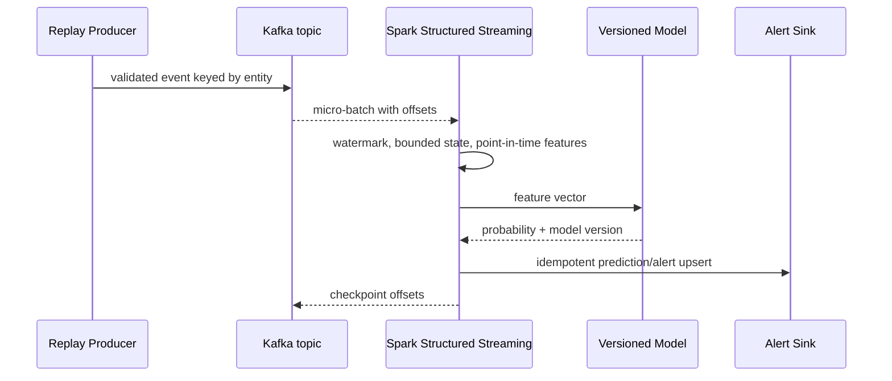

# FinGuard AI system design

## Scope

The system is a portfolio prototype for historical analysis and near-real-time scoring over the public ULB/Worldline anonymized dataset. It is not a regulated banking platform and does not claim production availability, fraud-loss reduction, or compliance.

## Functional requirements

1. Ingest a historical transaction source and preserve an immutable raw copy.
2. Validate schema and data quality; quarantine invalid records with reasons.
3. Produce Silver typed transactions and Gold point-in-time-safe features.
4. Train and evaluate a logistic baseline and CPU XGBoost model chronologically.
5. Replay historical events into Kafka and process them with Spark Structured Streaming.
6. Persist predictions and alerts idempotently for analysis.
7. Expose data-quality, model, latency, throughput, and resource measurements.

## Non-functional requirements

- Reproducible from a small fixture and pinned configuration.
- Bounded memory on an 8 GB laptop; local Spark uses `local[2]`.
- Clear batch/streaming feature parity and leakage controls.
- Recoverable jobs through checkpoints, deterministic outputs, and idempotent writes.
- No sensitive real-world data in the repository.

## Component responsibilities

| Component | Responsibility |
| --- | --- |
| Source adapter | Read CSV or future source behind a stable interface |
| Bronze writer | Add ingestion metadata and write immutable Parquet |
| Quality validator | Schema, completeness, validity, uniqueness, consistency, timeliness |
| Silver transformer | Cast, normalize, deduplicate, quarantine |
| Gold feature job | Build historical features using prior information only |
| Trainer | Fit preprocessing and model on training period; publish versioned artifact |
| Kafka producer | Serialize validated events, key by entity, retry boundedly, route failures to DLQ |
| Streaming scorer | Consume micro-batches, reproduce feature logic, score, write idempotently |
| Airflow | Schedule finite batch workflows; it does not own endless streams |
| Observability | Emit quality counts, model metrics, batch duration, throughput, and lag |

## Event flow

## Batch versus streaming

Batch is simpler, cheaper, and easier to backfill; it tolerates higher latency and is appropriate for training, reports, and historical recomputation. Streaming reduces detection latency but introduces state, watermarks, late events, checkpoint recovery, backpressure, and sink idempotency concerns. Kafka and Spark are justified in this portfolio because they make these distributed-system concerns explicit. For a few thousand local rows, a Python script is simpler and faster; the distributed tools become meaningful when event volume, parallel consumers, replayability, and failure isolation justify their operational cost.

## Storage and reliability

Parquet is the analytical format because it is columnar, compressible, schema-aware, and supports predicate pushdown. Bronze remains immutable. Silver contains accepted normalized rows; quarantine retains rejected rows and reason codes. Gold contains model-ready features and feature metadata. Streaming writes include an event ID, model version, processing timestamp, and deterministic deduplication key.

At-least-once delivery is realistic across Kafka and an external sink. Exactly-once processing inside Spark does not automatically make an arbitrary external database exactly once; the sink must support transactions or idempotent upserts. Checkpoints recover offsets and state, while watermarks bound state at the cost of dropping or separately handling events that arrive too late.

## Security and privacy

Use the public anonymized ULB/Worldline data for this project. In a real bank, identifiers would be tokenized, access would be least-privilege, secrets would not be committed, audit logs would be protected, and retention/deletion policy would be explicit. TLS, authentication, network isolation, model governance, and human review controls are future production concerns.

## Scaling path

The local topology has one broker, one Spark process, and local Parquet. Conceptually, scale by adding Kafka brokers and partitions, Spark executors, object storage, a metastore/catalog, and a durable serving store. Partition by event date and/or entity only after measuring skew; blindly increasing partitions can increase shuffle and scheduling overhead.
